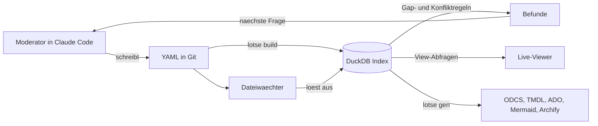

# Lotse — KI-gestütztes Moderationstool für die Anforderungserfassung

Konzept und Bauauftrag für Claude Code. Arbeitstitel `lotse`.

> [!abstract] Kernaussage
> Die Anforderung ist ein deskriptiver Graph in YAML-Dateien (Git ist die Wahrheit). DuckDB ist der daraus kompilierte, wegwerfbare Abfrage-Index. Claude Code ist der Moderator, eine deterministische CLI ist der Compiler. Jede Änderung am Graphen erscheint in unter zwei Sekunden in der Live-Visualisierung.

## 1. Ziel und Nicht-Ziele

**Ziel:** Ein Workshop-Werkzeug, das Anforderungen top-down erfasst (Entscheidung → Datenprodukt → Kennzahl → Dimension → Tabelle → Quelle), Lücken und Konflikte sofort sichtbar macht und daraus Artefakte für Microsoft Fabric und Azure DevOps generiert.

**Nicht-Ziele (v1):**
- Kein eigenes Chat-Frontend. Die Moderation läuft in Claude Code.
- Keine Report-Visuals. Der Prototyp endet beim semantischen Modell (TMDL).
- Kein Schreiben in produktive Fabric-Workspaces oder ADO-Projekte ohne ausdrückliche Freigabe. Standard ist Dry-Run.
- Keine automatische Konfliktlösung. Das Tool zeigt Konflikte, Menschen entscheiden.

## 2. Leitprinzipien

1. **Deskriptiv:** Der gesamte Zustand steht in YAML. Es gibt keinen Zustand, der nur in DuckDB, im Viewer oder im Chatverlauf existiert.
2. **Git-fähig:** Eine Datei pro Entität, stabile IDs, sortierte Schlüssel, keine Zeitstempel im Inhalt. Diffs bleiben klein und lesbar, Merges sind möglich.
3. **Deterministischer Kern:** Validierung, Gap-Analyse, Generierung und Rendering sind reiner Code. Das LLM formuliert Fragen und schreibt YAML, mehr nicht.
4. **DuckDB ist Cache:** `lotse build` erzeugt `.lotse/lotse.duckdb` vollständig aus den Dateien neu. Die Datei ist in `.gitignore`.
5. **Renderer sind austauschbar:** Ein Renderer bekommt eine View-Abfrage und liefert eine Darstellung. Live-Graph, Archify und Mermaid sind drei Implementierungen derselben Schnittstelle.
6. **Offline demonstrierbar:** Die Demo läuft ohne Fabric-, ADO- und LLM-Zugang.

## 3. Architektur



| Schicht | Technik | Aufgabe |
|---|---|---|
| Wahrheit | YAML + JSON Schema, Git | Anforderungsgraph |
| Index | DuckDB (Python-API) | Abfragen, Regeln, Views |
| Kern | Python 3.12, `uv`, Typer, Pydantic | `lotse` CLI |
| Live-Sicht | FastAPI + Server-Sent Events, Cytoscape.js mit ELK-Layout | Graph zur Laufzeit |
| Moderation | Claude Code: `CLAUDE.md`, Skills, Slash-Commands, Hook | Fragen, Erfassen, Rückspiegeln |
| Adapter | ODCS v3.1.0, TMDL, ADO (MCP oder REST), Archify, Mermaid | Generierte Artefakte |

## 4. Repository-Struktur

```
lotse/
├── CLAUDE.md                     # Regeln für den Moderator
├── .claude/
│   ├── skills/moderation/        # Fragetechnik je Stufe
│   ├── commands/                 # /lotse-start, /lotse-next, /lotse-recap
│   └── settings.json             # Hook: nach jedem Write -> lotse check
├── src/lotse/
│   ├── model/                    # Pydantic-Modelle, JSON-Schema-Export
│   ├── store/                    # YAML laden, DuckDB bauen
│   ├── rules/                    # *.sql, eine Regel pro Datei
│   ├── views/                    # *.sql, benannte Sichten
│   ├── render/                   # live, archify, mermaid
│   ├── gen/                      # odcs, tmdl, ado
│   └── cli.py
├── viewer/                       # eine HTML-Seite, kein Build-Schritt
├── demo/
│   ├── nordwind/                 # fertiges Beispiel-Workspace
│   └── replay/steps/             # nummerierte Patches für die Demo
├── tests/
└── workspaces/<name>/            # ein Anforderungs-Workspace (siehe 5)
```

## 5. Das deskriptive Modell

Ein Workspace ist ein Ordner:

```
workspaces/nordwind/
├── lotse.yaml          # Name, Zielplattform, Stufenstatus
├── decisions/          # Entscheidungen, die das Datenprodukt stützt
├── products/           # Datenprodukte (Report oder semantisches Modell)
├── measures/           # Kennzahlen
├── dimensions/         # Dimensionen und Hierarchien
├── tables/             # Gold-Tabellen (Fakten, Dimensionen)
├── sources/            # Quellsysteme und Quellobjekte
├── stakeholders/       # Personen und Rollen
├── statements/         # Aussagen aus der Session (Herkunft jeder Angabe)
└── questions/          # offene Fragen mit Owner
```

Beispiel `measures/auftragsbestand.yaml`:

```yaml
id: measure.auftragsbestand
name: Auftragsbestand
status: conflict            # draft | agreed | conflict
owner: stakeholder.controlling-leitung
grain: [dimension.kunde, dimension.produkt, dimension.monat]
definitions:
  - by: stakeholder.vertrieb-leitung
    text: Summe aller bestätigten, noch nicht gelieferten Auftragspositionen
    statement: statement.0012
  - by: stakeholder.controlling-leitung
    text: Bestätigte Aufträge abzüglich fakturierter Positionen
    statement: statement.0015
time_logic: Stichtag Monatsende
serves: [decision.kapazitaetsplanung]
from_tables: [table.fact_auftragsposition]
quality:
  - rule: not_negative
```

**Regeln für alle Entitäten:**
- `id` hat die Form `<typ>.<slug>` und ändert sich nie. Umbenennen ändert nur `name`.
- Beziehungen sind ID-Listen (`serves`, `from_tables`, `from_sources`, `grain`). Daraus entstehen die Kanten.
- Jede fachliche Angabe verweist über `statement` auf ihre Herkunft. So bleibt nachvollziehbar, wer was gesagt hat.
- Mehrere Einträge in `definitions` mit unterschiedlichem Text bedeuten Konflikt. Die Einigung besteht darin, auf einen Eintrag zu reduzieren und `status: agreed` zu setzen. Der Git-Diff dokumentiert die Entscheidung.

## 6. DuckDB-Index

`lotse build` liest alle YAML-Dateien, validiert gegen das JSON Schema und schreibt:

| Tabelle | Inhalt |
|---|---|
| `node(id, type, name, status, stage, file)` | jede Entität |
| `edge(src, dst, kind)` | jede Beziehung |
| `attr(id, key, value)` | flache Attribute für Regeln |
| `definition(measure_id, stakeholder_id, text)` | für Konfliktprüfung |
| `finding(rule, severity, node_id, message)` | Ergebnis der Regeln |

**Regeln sind SQL-Dateien.** Jede liefert Zeilen im Format von `finding`. Startumfang:

| Regel | Severity | Bedeutung |
|---|---|---|
| `measure_without_decision` | warn | Kennzahl stützt keine Entscheidung |
| `measure_without_table` | gap | Kennzahl hat keine Gold-Tabelle |
| `table_without_source` | gap | Tabelle hat keine Quelle |
| `measure_definition_conflict` | conflict | mehr als eine abweichende Definition |
| `missing_owner` | gap | Kennzahl oder Produkt ohne Owner |
| `missing_grain` | gap | Kennzahl ohne Granularität |
| `dimension_unused` | info | Dimension wird von keiner Kennzahl genutzt |
| `dangling_reference` | error | ID-Verweis zeigt ins Leere |

`lotse next` sortiert die Befunde nach Stufe und Severity und gibt den wichtigsten als strukturierte Frage-Vorlage aus. Der Moderator formuliert daraus die Frage. Die Reihenfolge der Moderation ist damit reproduzierbar und testbar.

## 7. Visualisierung zur Laufzeit

**Entscheidung:** Zwei Renderer mit getrennten Aufgaben statt Archify für alles.

| Renderer | Zweck | Begründung |
|---|---|---|
| **Live-Graph** (Cytoscape.js) | Arbeitsfläche im Workshop | Der Graph hat schnell 50 bis 150 Knoten und braucht Statusfarben, Filter und Fokus auf den zuletzt geänderten Knoten. |
| **Archify** (ab v3.2) | Ergebnisbilder zum Teilen | Typen *Data Flow* und *ERD* passen für Lineage und Modell. Archify ist auf fokussierte Diagramme mit rund 8 bis 12 Kernknoten ausgelegt und dokumentiert keinen Knotenstatus. |
| **Mermaid** | Diagramme in Git, ADO-Wiki, Obsidian | Text im Repo, rendert ohne Werkzeug. |

**Live-Graph, Verhalten:**
- Spalten von links nach rechts: Entscheidung, Datenprodukt, Kennzahl, Dimension, Tabelle, Quelle.
- Farbe nach Status: einig, Entwurf, Lücke, Konflikt. Zusätzlich ein Symbol, damit die Bedeutung nicht nur an der Farbe hängt.
- Neue oder geänderte Knoten pulsieren kurz, die Sicht zentriert darauf.
- Seitenleiste: Befundliste aus `finding`, Klick springt zum Knoten.
- Klick auf einen Knoten zeigt Definitionen, Herkunft und offene Fragen.
- Fortschrittsbalken je Stufe (Anteil der Knoten ohne Befund).

**Ablauf:** `lotse serve` startet Dateiwächter und Webserver. Dateiänderung → inkrementeller Build → Diff der Knoten und Kanten per Server-Sent Events → Viewer aktualisiert ohne Neuladen. Ziel: unter zwei Sekunden vom Speichern bis zum Bild.

**Archify-Anbindung:** `lotse render archify --view lineage` schreibt `out/lineage.json` im Archify-Format. `archify preview` beobachtet die Datei und lädt neu. Views aggregieren (zum Beispiel Kennzahlen zu Themenblöcken), damit die Diagramme im sinnvollen Größenbereich bleiben. Das Archify-JSON-Schema ist zu Beginn von M4 gegen die aktuelle Schema-Referenz zu prüfen.

## 8. CLI

| Befehl | Wirkung |
|---|---|
| `lotse init <name>` | Workspace mit Grundgerüst anlegen |
| `lotse build` | YAML validieren, DuckDB neu bauen, Regeln ausführen |
| `lotse check` | wie `build`, Exit-Code ≠ 0 bei `error` (für Hook und CI) |
| `lotse next [--json]` | wichtigster offener Befund als Frage-Vorlage |
| `lotse status` | Fortschritt je Stufe, Zahl der Befunde |
| `lotse serve` | Live-Viewer starten |
| `lotse render <mermaid\|archify> --view <name>` | statische Sicht erzeugen |
| `lotse gen odcs` | ein ODCS-YAML je Datenprodukt, gegen offizielles Schema validiert |
| `lotse gen tmdl` | TMDL-Ordner mit Tabellen, Beziehungen, Measures als Platzhalter-DAX |
| `lotse gen ado [--apply]` | Epics, Features, Stories als JSON; `--apply` schreibt nach ADO |
| `lotse demo [--replay]` | Demo starten (siehe 10) |

Alle Generatoren sind idempotent. Gleicher Input ergibt byte-gleichen Output.

## 9. Claude Code als Moderator

**`CLAUDE.md` (Kernregeln):**
- Vor jeder Frage `lotse next --json` aufrufen. Nie eine Frage erfinden, wenn ein Befund offen ist.
- Pro Antwort genau eine Frage stellen.
- Antworten zuerst als `statement` ablegen, dann die betroffene Entität ändern.
- Nie eine Definition glätten. Widersprüche als zweite Definition erfassen.
- Nach jeder Änderung das Erfasste in einem Satz zurückspiegeln.
- Stufe erst wechseln, wenn `lotse status` für die Stufe keine `gap`-Befunde zeigt oder der Mensch es ausdrücklich will.

**Slash-Commands:** `/lotse-start` (Workspace wählen, Viewer starten, Stufe 1 eröffnen), `/lotse-next` (nächste Frage), `/lotse-recap` (Zusammenfassung der Session plus Commit-Vorschlag), `/lotse-decide <measure>` (Konflikt auflösen, Entscheidung dokumentieren).

**Hook:** Nach jedem Schreibzugriff unter `workspaces/` läuft `lotse check`. Schemafehler gehen direkt an den Moderator zurück.

**Commits:** Ein Commit je abgeschlossener Frage oder Entscheidung, Nachricht im Format `req(<stufe>): <was sich fachlich geändert hat>`. Die Git-Historie ist damit das Protokoll des Workshops.

**Betriebsmodus v1:** Live im Workshop, eine Person bedient Claude Code, der Viewer läuft auf dem Beamer. Asynchrone Einzelinterviews nutzen dieselben Dateien auf eigenen Branches und werden per Merge zusammengeführt. Konflikte im Merge sind dann fachliche Konflikte und landen als zweite Definition im Modell.

## 10. Demo

**Anspruch:** Ein Befehl, fünf Minuten, kein Netz, und der Zuschauer sieht einen Konflikt entstehen und verschwinden.

**Szenario:** Fiktive Nordwind Maschinenbau GmbH. Datenprodukt *Auftragsbestand-Cockpit*. Vier Stakeholder, sechs Kennzahlen, fünf Dimensionen, drei Quellsysteme.

**`lotse demo --replay`** spielt nummerierte Patches aus `demo/replay/steps/` gegen einen leeren Workspace ab, jeder Schritt mit eingeblendeter Frage und Antwort. Leertaste für den nächsten Schritt, `--auto` für Selbstlauf.

| Akt | Was passiert | Was man sieht |
|---|---|---|
| 1. Entscheidung | Kapazitätsplanung als Zweck erfasst | erster Knoten, Rest leer |
| 2. Kennzahlen | sechs Kennzahlen entstehen | Graph wächst, viele Lücken |
| 3. Konflikt | Vertrieb und Controlling definieren *Auftragsbestand* verschieden | Knoten wechselt auf Konflikt, Befund erscheint |
| 4. Realitätscheck | *Liefertreue* hat keine Quelle für das zugesagte Datum | Lücke bis zur Quelle sichtbar |
| 5. Einigung | `/lotse-decide`, Definition reduziert | Konflikt weg, Git-Diff zeigt die Entscheidung |
| 6. Ergebnis | `lotse gen odcs`, `gen tmdl`, `gen ado` | Contract, Modellordner, Backlog-Vorschau, Lineage-Bild |

**Zusätzlich:**
- `demo/nordwind/` enthält den fertigen Endzustand zum freien Erkunden.
- `demo/SCRIPT.md` enthält den Sprechtext je Akt.
- `lotse demo --record` erzeugt per Playwright ein Video des Replays für die README.
- Die Replay-Schritte sind zugleich der End-to-End-Test: nach jedem Schritt wird die erwartete Befundliste geprüft.

## 11. Meilensteine

| Nr. | Inhalt | Abnahme |
|---|---|---|
| M1 | Modell, Schema, `init`, `build`, `check`, Regeln | Nordwind-Endzustand baut fehlerfrei, acht Regeln mit Tests |
| M2 | `serve` und Live-Viewer | Dateiänderung erscheint in unter zwei Sekunden, Statusfarben und Befundliste funktionieren |
| M3 | Replay-Demo | `lotse demo --replay --auto` läuft offline durch, Erwartungen je Schritt grün |
| M4 | Generatoren ODCS, TMDL, Mermaid, Archify | ODCS validiert gegen offizielles Schema, TMDL öffnet in Power BI Desktop, Output byte-stabil |
| M5 | Claude-Code-Moderation | Eine echte Session von leer bis Stufe 3 ohne manuelles YAML-Editieren |
| M6 | ADO-Adapter mit `--apply` | Work Items mit Hierarchie in einem Testprojekt, zweiter Lauf erzeugt keine Duplikate |

Reihenfolge ist bewusst: Die Demo (M3) steht vor den Adaptern, weil sie den Kernnutzen beweist und als Regressionstest dient.

## 12. Qualität

- `pytest` für Regeln (je Regel ein positives und ein negatives Fixture) und Generatoren (Snapshot-Tests).
- `ruff` und `mypy --strict` im Kern.
- CI führt `lotse check` auf allen Workspaces und den Replay-Test aus.
- Kein Netzwerkzugriff in Tests.

> [!warning] Kritische Annahme
> Das Modell unterstellt, dass sich Anforderungen sauber als Graph aus sechs Entitätstypen fassen lassen. Fachlogik in Transformationen (Sonderfälle, Ausnahmen, Historisierung) passt dort nur als Freitext hinein. Wenn in echten Sessions mehr als ein Drittel der Aussagen im Freitext landet, braucht das Modell einen siebten Typ `rule`.

> [!question] Offene Entscheidungen
> - Soll `lotse gen ado` über den Remote-MCP-Server oder direkt über REST schreiben? REST ist ohne Agent testbar, MCP ist weniger Code.
> - Soll die DPU_REQ-Excel-Struktur als Import und Export unterstützt werden (Brücke zum bestehenden ODCS-Konverter)?
> - Reicht ein Bediener im Workshop, oder braucht es eine Transkript-Anbindung?

> [!tip] Nächster Schritt
> Claude Code mit M1 beauftragen: "Lies `lotse-konzept.md`, setze M1 um, beginne mit dem Nordwind-Endzustand als Fixture und leite daraus Schema und Regeln ab."
